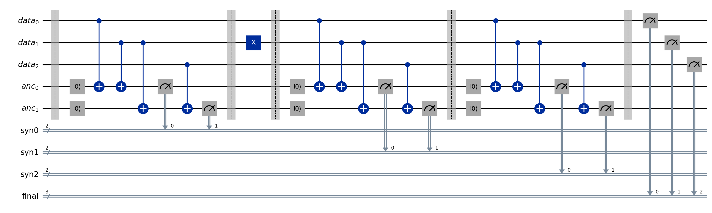
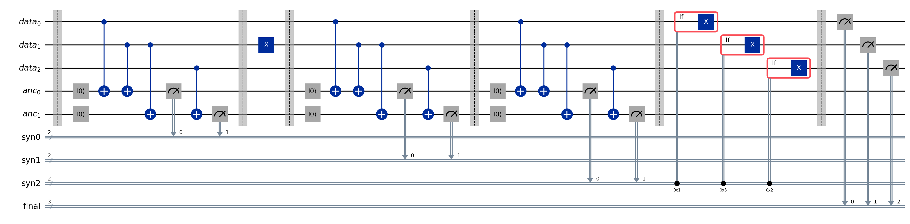
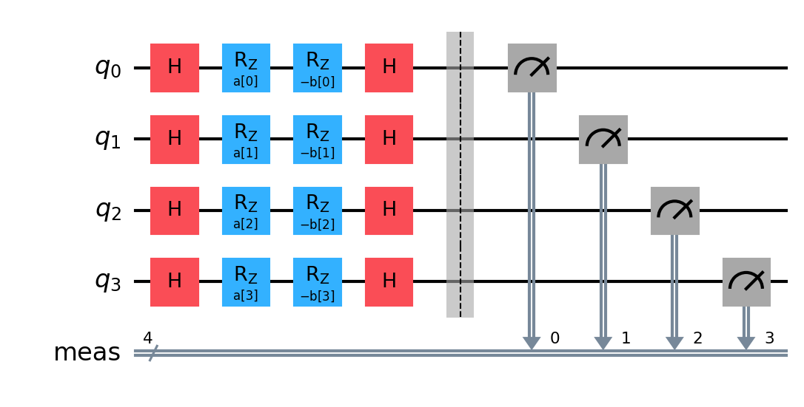
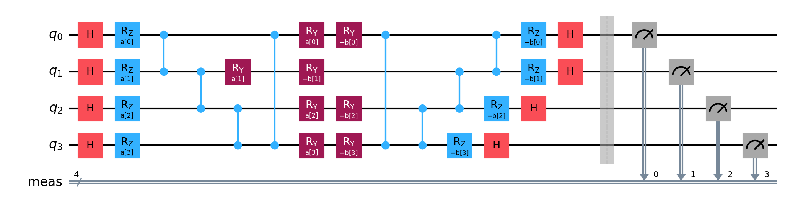
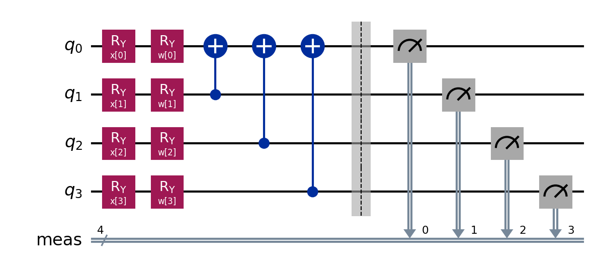
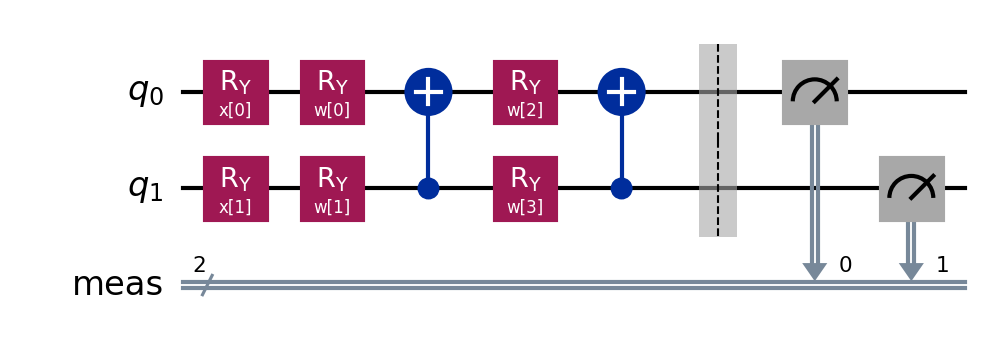

# Q-DecodeQEC: Decoding Real Quantum Error-Correction Syndromes on IBM Quantum Hardware
### IBM Fall Fest 2026 | Trinexis x IEEE | Domain: Quantum Error Correction (Fault-Tolerant Quantum Computing) | Participant Guide

---

## 1. Problem statement

### 1.1 Context
Quantum bits are fragile. Every gate, every idle microsecond and every readout adds a small chance of error, and useful algorithms need error rates far below what physical qubits deliver. **Quantum error correction (QEC)** closes that gap: information is stored redundantly across several physical qubits (the **data qubits**), and extra **ancilla qubits** repeatedly measure parity checks (the **stabilisers**) that reveal that an error happened without revealing the stored information. The list of check outcomes is the **syndrome**.

A **decoder** is the classical program that reads the syndrome and decides which correction to apply (or, equivalently, whether the stored **logical qubit** was flipped). Decoding is the bottleneck of every QEC architecture:

1. **Accuracy.** A wrong decision creates a *logical error*, which is exactly what QEC exists to prevent.
2. **Speed.** Syndromes arrive every microsecond or so on a real machine; a slow decoder makes the backlog grow without bound.
3. **Hardware realism.** Real syndromes come from imperfect measurements, drifting qubits and correlated noise, not from the idealised noise models used in textbooks.

The classical answer is **minimum-weight perfect matching (MWPM)** on a graph built from the code. Machine-learning decoders instead *learn* the mapping from syndrome to correction from data. A **routed decoder** combines both: it estimates how hard each syndrome is and sends easy ones to a cheap path and hard ones to the strongest decoder, to save compute without losing accuracy.

This challenge uses the smallest meaningful code, a **distance-3 bit-flip repetition code with three syndrome rounds**, executed on a **real IBM quantum computer**. It is a research prototype. It protects against bit-flip (X) errors only, it does not demonstrate fault tolerance, and it makes no claim about speed advantage of any decoder over the control-system latency of a real machine.

### 1.2 Your task
Build and compare decoders that answer:

> Given the detector events of **one shot** of a real repetition-code memory experiment, can a decoder predict whether the logical observable flipped, on shots it has never seen, and does a hardware-aware routed decoder improve on matching alone and on a plain neural network?

In addition, you will build **two versions of the memory circuit** (without and with on-device correction) and run both on real hardware.

| ID | Method | Type | Status |
|---|---|---|---|
| **M0** | Minimum-weight perfect matching (PyMatching) plus two trivial controls | Classical algorithmic control | Mandatory |
| **M1** | Multilayer perceptron (MLP) syndrome classifier | Classical ML | Mandatory |
| **M2** | **MOR router**: difficulty classes, per-class choice between identity, matching and the MLP, with calibrated confidence | Hybrid classical (routed) | Mandatory |
| **S1** | Quantum-kernel SVM (QSVC), kernel measured on a real IBM quantum computer | Hybrid quantum, kernel | **Optional stretch, only if time permits** |
| **S2** | QAOA feature selection, then a Variational Quantum Classifier (VQC) | Hybrid quantum, variational | **Optional stretch, only if time permits** |

The mandatory quantum work is **Part A**: running the passive and the actively corrected memory circuits on a **real IBM quantum computer** through IBM Cloud within about **10 minutes of QPU time**. The stretch methods use the remaining budget.

### 1.3 Ground rules
- **No quantum simulation, ever.** Forbidden: `qiskit_aer`, `Aer`, `AerSimulator`, `Statevector*`, `DensityMatrix`, `BasicSimulator`, `Fake*Backend`, `StatevectorSampler`, `StatevectorEstimator`, `NumPyMinimumEigensolver` as a stand-in for QAOA, tensor-network or noisy simulators, mocked or hand-typed counts, cached demo outputs.
- Every quantum number (syndrome shot, kernel entry, QAOA objective, VQC loss, VQC prediction) must come from measurements returned by a real IBM backend. A classical optimiser may *propose* circuit parameters; it may never *invent* a circuit's result. Closed-form formulas are allowed only as clearly labelled **reference controls**, never as quantum data.
- Local CPU (or GPU) is allowed for pandas, scikit-learn, PyTorch, PyMatching, feature engineering, transpilation and plotting.
- **Training data come only from `data/`.** No other syndrome datasets, no simulated syndromes, no pretrained decoders. Syndromes you measure yourself in Part A may be used for evaluation and analysis only, clearly labelled as such.
- If something is unavailable (IBM token, quota, backend), stop that phase, mark it `BLOCKED_<REASON>` (for example `BLOCKED_IBM_ACCESS`, `BUDGET_EXHAUSTED`) and say so. Never fill the gap with fake or simulated data.
- Never put API keys in files or notebooks. Use environment variables.
- Never use a label or a label-derived column as a model input (Section 3.4).

### 1.4 The problem in practice
Picture the control room of a quantum computer. Every few microseconds the machine reports the parity-check outcomes of the latest round. Comparing each round with the previous one gives **detector events**: a 1 means "this check changed", which signals that something happened between two rounds. Your system must turn the detector events of one shot into one decision: **was the logical qubit flipped?**

The pipeline has four stages, and each one can fail independently:

| Stage | What happens | How it can fail | What you report |
|---|---|---|---|
| 1. Acquire | Run the memory circuit on real hardware and read every syndrome round and the final data readout **for the same shot** | Registers misaligned, simulator used by accident, drifting qubits | Job IDs, shot counts, backend, layout |
| 2. Form detectors | Turn raw check outcomes into detector events (round-to-round differences plus a final-readout round); undo the commanded correction in the active circuit | Wrong bit order, feedback not reversed | Detector shape and consistency checks |
| 3. Decode | M0 matching, M1 MLP and M2 router predict the logical flip | Overfitting, leakage, uncalibrated outputs, routing chosen on test data | LER, accuracy against the no-flip baseline, intervals |
| 4. Route and measure cost | M2 sends each shot to a decoder by difficulty; you measure per-stage latency | A router that is slower than the decoders it replaces | Routing shares, latency p50/p95 |

Why this is hard: the labels come from real readouts, so some flips are **not visible in the detectors at all** (for example relaxation of a prepared state or readout errors), which caps what any decoder can reach; the input space is tiny, so a lookup table is a strong competitor and the interesting question is what a learned or routed decoder adds beyond it; and you must be honest about statistical resolution and about whether the router's extra machinery pays for itself.

### 1.5 Solution roadmap
Work through these steps in order. Each produces something the next one needs.

| Step | What you do | What you produce | Details |
|---|---|---|---|
| 1 | Set up the notebook: one `config` cell, credentials from environment variables, simulator-ban scan | Config cell, pinned versions | 1.7, 4.4 |
| 2 | Verify data checksums, audit the schema, build the feature (leakage) register | Hashes, schema audit, feature register | 3.1 to 3.4 |
| 3 | Explore the data (class balance, detector weights, per-round activity, pattern frequency) | EDA figures | 3.5 |
| 4 | Build the matching graph and the controls (M0, no-flip, pattern lookup) | Control scores | 3.7, 4.1 |
| 5 | Train M1 (MLP); choose settings by stratified cross-validation inside the training file | Frozen M1, ablations | 4.2 |
| 6 | Build M2 (difficulty classes, per-class routing, calibration) on splits of the training file | Frozen M2, routing table | 4.3 |
| 7 | Score M0, M1, M2 on `internal_test_1000`, then **freeze** (hashes, config) and write predictions for the unlabelled `final_test_inputs` | Metrics with intervals; predictions CSVs | 3.5, 6 |
| 8 | QPU preflight: quota, backend, physical qubits, confirm it is not a simulator; tiny calibration job | Backend and layout record | 5.3 |
| 9 | **Part A:** build passive (BEFORE) and active (AFTER) memory circuits, run them interleaved in one job | Real syndromes, before/after table | 5.1, 5.2 |
| 10 | Score the frozen M0, M1, M2 on your own fresh Part A shots (optional out-of-time check) | Drift observation | 3.5 |
| 11 | Re-query every job ID, evaluate all methods on identical shots with paired bootstrap, write findings | Benchmark table, charts, findings | 6, 7 |
| 12 | Single-syndrome demo: one detector vector in, decisions out for every method | Annotated example per fault class | 2.2 |
| 13 | **Only if time permits:** stretch quantum decoders S1 and S2 | Hardware-measured kernels, QAOA counts, VQC predictions | 4.5, 5.4 |

Order the QPU work so cheap, informative jobs come first (calibration, then Part A, then any stretch work) and keep at least 20 % of the budget in reserve for retries. Save each job ID the moment it is submitted.

How to decide when you finish:
- If the router or a stretch method does not improve on the plain MLP or on the pattern-lookup control, report it as measured. A well-explained negative result is acceptable; an unsupported "improved" claim is not.
- Report intervals and paired deltas; do not rank methods on noise.
- Never describe quantum advantage unless your paired intervals support it.

### 1.6 Common mistakes to avoid
- Using `final_data`, `observable_error`, `circuit_name`, `fault_type`, `fault_label`, `injected_*`, `initial_bit`, `detector_event_count`, `has_detection_event` or any label-derived column as a model input (Section 3.4).
- Tuning on the internal test file after looking at its scores without labelling the change post-hoc, or touching the final-test inputs for anything except writing frozen predictions. The final-test answers are held by the organisers; never try to recover them.
- Fitting scalers, thresholds, calibration, matching weights or the **routing table** on test data. The router must choose per class on a training slice it did not learn from.
- Reporting accuracy without the **always-predict-no-flip baseline**. A quarter of the shots are flips; a model can look accurate and decode nothing.
- Parsing hardware results with `get_counts()` on separate registers. That erases which syndrome and which final readout belong to the same shot. Use per-shot bitstrings per register.
- In the active (corrected) circuit, forming the final detectors **without reversing the commanded correction**. The detector history must describe what happened *before* the feedback gate.
- Comparing the passive and active circuits from **different jobs**. Qubits drift; interleave both versions in one job.
- Claiming the router is faster without timing it against its own components at batch size 1. Routing adds work; show where it pays off, or that it does not.
- Resubmitting a job after a notebook restart instead of retrieving it with `service.job(job_id)`, which wastes QPU time.
- Using Qiskit Machine Learning's default `VQC` or `SamplerQNN` in a stretch attempt without proving its sampler is real hardware (the defaults are local simulators).
- Filling a gap (no token, no quota) with fake or cached outputs instead of marking the phase `BLOCKED_<REASON>`.

### 1.7 Get your IBM Quantum account (10 minutes of QPU time)
The free **Open Plan** on IBM Quantum Platform gives you about 10 minutes of real QPU time per rolling 28-day window, which is the budget this challenge is built around. Do this before the event because account creation and identity checks can take a while. IBM changes its portal from time to time, so if a screen differs from the steps below, follow IBM's current on-screen instructions.

**Create the account**
1. Open https://quantum.cloud.ibm.com and choose **Sign up** (or **Log in** with an existing IBMid).
2. Register with an email address, verify it and accept the terms. This creates an IBM Cloud account.
3. Choose the **Open Plan** and create an instance. It needs no payment details; do not pick a paid plan.

**Collect the three things your notebook needs**

| Item | Where to find it | Environment variable | Notes |
|---|---|---|---|
| API key | IBM Quantum Platform dashboard (API key panel) or https://cloud.ibm.com/iam/apikeys | `QISKIT_IBM_TOKEN` | Shown once when created; copy it right away |
| Instance CRN | Open the instance on the Instances page and copy its CRN | `QISKIT_IBM_INSTANCE` | Long identifier that starts with `crn:v1:` |
| Channel | Fixed value `ibm_quantum_platform` | `QISKIT_IBM_CHANNEL` | Name used by recent `qiskit-ibm-runtime`; check against your installed version |

Set the three variables in your shell before starting Jupyter, then create the `QiskitRuntimeService` with no arguments so it reads them. Print the remaining QPU time with `service.usage()` and record it. If that call fails, that is `BLOCKED_IBM_ACCESS`: stop the quantum phases and report it.

**Using the 10 minutes well**
- QPU time is billed for execution only; queue waiting does not count. Develop and unit-test all classical code first, because the allowance resets on a rolling window and test runs consume it.
- The key is a password: never commit it, never paste it into a cell, and delete it in IBM Cloud if it is ever exposed.
- Choose a backend that supports **dynamic circuits** (mid-circuit measurement, reset and conditional gates). Check that `if_else` appears in `backend.operation_names` before you plan Part A.

**Install the environment (Python 3.12 recommended)**

| Package | Version tested |
|---|---|
| qiskit | 2.5.0 |
| qiskit-ibm-runtime | 0.48.0 |
| pymatching | 2.4.0 |
| pyarrow | 24.0.0 |
| pandas | 2.3.2 |
| numpy | 2.1.0 |
| scipy | 1.18.0 |
| scikit-learn | 1.7.1 |
| matplotlib | 3.10.6 |
| pylatexenc | 2.10 |
| joblib | 1.5.3 |
| ipykernel | 6.31.0 |
| nbformat | 5.10.4 |
| nbconvert | 7.17.1 |

Optional: PyTorch (any recent build) if you prefer a PyTorch MLP. Newer or older versions are acceptable if you print them in the notebook and say so.

---

## 2. Expected outcome

### 2.1 What you must submit
1. **One executed Jupyter notebook** (`.ipynb`, outputs saved, runs top to bottom without errors) containing the full classical workflow, the real-hardware Part A, and any stretch work you attempted.
2. **Evidence files**: IBM job IDs, raw per-shot measurement records, metric tables, per-shot predictions, figures, the saved circuits (QPY) and a QPU usage ledger.
3. **A findings section** at the end of the notebook stating which method you would choose and why, backed by your own numbers, including negative results.
4. Predictions as CSV, one file per mandatory method: `predictions_final_test_M0.csv`, `predictions_final_test_M1.csv` and `predictions_final_test_M2.csv`. Each has one row per `record_id` of `data/final_test_inputs.parquet` and the columns `record_id`, `predicted_flip` (0 or 1) and `p_flip` (probability, or `NaN` if the method has none). They are written from your frozen models. The organisers score these files; no answers are provided to participants. Add one CSV per method for the internal test.
5. The repository deliverables listed in `CONTRIBUTING.md` (README, `src/`, report, slides, demo video link).

### 2.2 What your solution must demonstrate

| # | Outcome | How it is judged |
|---|---|---|
| 1 | A leakage-safe data pipeline: checksums, schema audit, feature register, frozen configuration | Printed checks, hashes, documented exclusions |
| 2 | Three classical decoders built and compared: M0 (matching plus controls), M1 (MLP), M2 (MOR router), scored on the internal test (labelled) and used to predict the unlabelled final test | LER, accuracy versus baseline, balanced accuracy, F1, bootstrap intervals |
| 3 | A router that is **honest**: per-class routing chosen on training data only, routing shares, per-class errors of every candidate decoder, calibration before and after, latency per stage | Routing table, per-class table, latency table |
| 4 | A fair comparison on **identical shots** with identical decision rules | Same record IDs, paired bootstrap deltas versus M0 and M1 |
| 5 | A circuit **BEFORE/AFTER** comparison on a real IBM backend: the passive memory circuit versus the actively corrected one, **created in your notebook and printed** (logical and transpiled), run interleaved in one job | Printed diagrams, depth and gate counts, QPY files, job IDs, per-configuration table |
| 6 | Honest interpretation: every insight matches printed numbers | Insight text versus outputs; no unsupported "improved" claims |
| 7 | A **single-syndrome demo**: one detector vector in, decisions out for every method, with the ground truth where it exists | Worked example per fault class, status labels |
| 8 | An end-goal scorecard comparing all methods on accuracy, cost, latency and risk | Final comparison table and chart |
| 9 | **Optional stretch:** a quantum decoder (S1 and/or S2) measured on real hardware with BEFORE/AFTER circuits | Job IDs, raw counts, QPU seconds, honest comparison on a small matched cohort |

### 2.3 Target to aim for
- **M1** should clearly beat the always-no-flip control on the internal test, and you should say how it compares with M0 matching and with the pattern-lookup control, with intervals.
- **M2** should be judged on whether routing preserves or improves accuracy and what it does to compute and latency. Matching or falling short of the strongest single decoder is a valid, reportable outcome if it is measured and explained.
- Quantum stretch methods are judged on **correctness of execution and honesty of analysis**, not on beating the classical decoders. Do not claim quantum advantage; the quantum cohort is far too small to support it.
- "Real time" in this challenge means the **decode latency you measure** (single syndrome, batch size 1) and the **on-device feedback** of the active circuit. No microsecond closed loop between your computer and the QPU is expected or should be claimed.

---

## 3. Data

All data are in the `data/` folder of this repository. **Read `data/README.md` first**: it holds the full data card (source, schema, statistics, caveats, loading snippets).

### 3.1 Source (the only allowed training source)
Shots measured on a **real IBM Quantum processor** (`ibm_marrakesh`) running a distance-3, three-round bit-flip repetition-code memory, plus one later hardware job used as an unlabelled final test. Nothing in `data/` is simulated and nothing needs to be downloaded from anywhere else. Log the SHA-256 of every file (`data/SHA256SUMS.txt`).

### 3.2 Files

| File | Rows | Content | Used for |
|---|---|---|---|
| `train_4000.parquet` | 4,000 shots | Detectors, raw syndromes, labels, fault metadata | Fit everything |
| `internal_test_1000.parquet` | 1,000 shots | Same schema, labelled | Model selection and development |
| `final_test_inputs.parquet` | 2,000 shots | `record_id`, `syndrome`, `detectors` only, **no labels** | Final test: predict and submit; scored by the organisers |
| `raw/syndromes_d3_r3_v1/` | 8 circuits | Per-shot raw registers (`.npz`), the transpiled circuits that ran (`.qpy`), job manifest with calibration snapshot, IBM verification record | Provenance, circuit inspection |
| `dataset_card.json` | n/a | Machine-readable summary of the labelled job | Provenance |
| `SHA256SUMS.txt` | n/a | Checksums | Integrity check |

The labelled shots come from one IBM job (8 circuits, 625 shots each, split stratified by circuit: 500 train and 125 test per circuit). The final-test shots come from a **later, separate** hardware job, so that file also measures robustness to drift.

### 3.3 Task definition and official scoring
- **Unit of prediction:** one shot, identified by `record_id`.
- **Input:** the 8 binary `detectors` of that shot (the 6 raw `syndrome` bits are an equivalent alternative representation of the check history).
- **Target:** `observable_error` (1 if the logical observable flipped, 0 otherwise). It is the raw readout of data qubit 0 compared with the prepared logical bit. A decoder's prediction `p` is correct if `p == observable_error`.
- **Primary metric:** **logical error rate after decoding (LER)** = share of shots where `p != observable_error`. The **raw LER** (no decoding, predict 0 everywhere) is the "before" number you compare against. Report LER with a bootstrap interval.
- **Secondary metrics:** accuracy against the always-no-flip baseline, balanced accuracy, precision, recall and F1 of the flip class, confusion matrix, calibration error for probabilistic models.

### 3.4 Features: what you may and may not use

| Group | Columns | Rule |
|---|---|---|
| **Query inputs** | `detectors` (8 bits); `syndrome` (6 bits, redundant representation) | The only allowed model inputs on every split |
| **Identifiers** | `record_id`, `shot_id` | Joining and reporting only; meaningless |
| **Provenance** | `job_id`, `backend`, `distance`, `rounds` | Constants; reporting only |
| **Labels and audit** | `observable_error`, `final_data`, `initial_bit`, `fault_type`, `injected_x_qubit`, `injected_after_round`, `fault_label`, `circuit_name`, `detector_event_count`, `has_detection_event` | Training targets, stratification, EDA and reporting only. **Never** a query-time input |

Publish your feature register (every column, its group, your decision and why) in the notebook. `final_data` and `initial_bit` determine the label exactly and are forbidden; the fault columns describe the injected cause and are forbidden for the flip task.

### 3.5 Cohorts and how they are used

| Cohort | Shots | Use |
|---|---|---|
| Train | 4,000 | Fit scalers, classifiers, matching weights, the router and calibration (on disjoint slices of train). Use stratified k-fold inside it (stratify by `circuit_name`). |
| Internal test | 1,000 (labelled) | Your evaluation set for M0, M1 and M2. Choose hyperparameters by cross-validation inside the training set so this cohort stays clean. |
| Final test | 2,000 (unlabelled) | Freeze your models, write predictions, submit them. Never used for fitting, scaling or tuning. |
| Stretch quantum cohort | 80 shots of the internal test, plus 12 training anchors and 12 VQC training shots | Only if you attempt S1 or S2 (Section 4.5) |
| Your live shots | Whatever you measure in Part A | Optional extra out-of-time evaluation of frozen models. Label as such; never train on them. |

### 3.6 Preprocessing rules
1. **Verify and audit.** Checksums, row counts, null counts, bit ranges (`detectors` and `syndrome` must be 0 or 1), fixed list lengths (8 and 6). Report what you observe.
2. **Detector layout.** `detectors[2*t + i]` is check `i` (parity of data qubits `i` and `i+1`) in time slice `t`, with `t = 0, 1, 2` the round-to-round changes of the three syndrome rounds (the first compared with an all-zero start) and `t = 3` the final data-readout parities compared with the last syndrome round. Verify this against `data/README.md` on a few rows.
3. **Order of bits.** Raw hardware register strings are little-endian (bit 0 is the rightmost character). Document how you parse them.
4. **Fit on training only:** scalers, selected features, matching-edge weights, thresholds, calibration and the routing table. Never on test data.
5. **Imbalance.** About a quarter of the shots are flips. Decide explicitly how you treat this (class weights, thresholds chosen on training folds) and say why.
6. **Duplicates.** The input space is small and many shots share the same detector pattern. Report the number of distinct patterns per split and what fraction of test patterns never occurred in training.
7. Save the configuration, seeds and the `record_id` of every cohort so a reviewer can reproduce your run.

### 3.7 The matching graph (needed for M0)
Nodes are the 8 detectors, indexed `n(t, i) = 2*t + i`. Build a PyMatching graph with these edges, all of weight 1 unless you select weights on training data:
- boundary edges at `n(t, 0)` **carrying fault id 0** and at `n(t, 1)` (no fault id), for `t = 0..3` (an X error on data qubit 0 flips the logical observable; on data qubit 2 it does not);
- one edge between `n(t, 0)` and `n(t, 1)` for each `t` (an X error on the middle data qubit);
- temporal edges `n(t, i)` to `n(t+1, i)` for `t = 0..2` and `i = 0, 1` (a faulty parity measurement).

PyMatching's batch decoder then returns the predicted flip of the logical observable per shot.

---

## 4. Methods to implement and compare

| # | Method | Type | Open-source stack | Status |
|---|---|---|---|---|
| **M0** | **Matching decoder plus trivial controls** | Classical algorithmic control | `pymatching`, `numpy` | Mandatory |
| **M1** | **MLP syndrome classifier** | Classical ML | `scikit-learn` or `torch` | Mandatory |
| **M2** | **MOR router** (difficulty classes, per-class routing, calibration) | Routed classical hybrid | the stack of M0 and M1, `scipy` | Mandatory |
| **S1** | Quantum-kernel SVM (QSVC) | Hybrid quantum, kernel | `qiskit`, `qiskit-ibm-runtime`, `sklearn.svm.SVC` with a precomputed kernel | Optional stretch |
| **S2** | QAOA feature selection, then VQC | Hybrid quantum, variational | `qiskit`, `qiskit-ibm-runtime`, an optimiser written by you | Optional stretch |

### 4.1 M0: controls
1. **No-flip control:** predict 0 for every shot. This is the "before decoding" reference and the accuracy baseline.
2. **Pattern-lookup control:** for each distinct detector pattern seen in training, predict the majority label (ties to 0); for unseen patterns predict 0. Report how many test shots hit an unseen pattern.
3. **Matching (MWPM):** the graph of Section 3.7 decoded with PyMatching. Select the ratio of measurement-edge weight to data-edge weight on training data only (for example a small grid scored by cross-validated LER) and report the choice.

### 4.2 M1: MLP classifier
1. **Input:** the 8 detector bits. Do not add any column from the label group.
2. **Model:** a small multilayer perceptron with a single output giving the probability of a logical flip. Suggested search space: one to three hidden layers of 16 to 128 units, ReLU activations, L2 weight decay, early stopping on a validation slice. Choose settings by stratified cross-validation inside `train_4000`.
3. **Imbalance and threshold:** use class weighting or an equivalent, and choose the decision threshold on validation data, not on the test file.
4. **Ablations:** with versus without class weights; threshold 0.5 versus the tuned threshold; two network sizes.
5. **Freeze** the chosen M1 and write `predictions_final_test_M1.csv`.

### 4.3 M2: the MOR router
M2 is a five-stage pipeline built from M0 and M1. Fit it on **three disjoint slices of the training file** (about 60 % fit, 20 % validation, 20 % routing, stratified by circuit, fixed seed), never on test data.

| Stage | What it does | How it is fitted |
|---|---|---|
| 1. Difficulty | Count the detector events of a shot (its weight `w`). **TRIVIAL** if `w = 0`, **EASY** if `w` is 1 or 2, **HARD** if `w` is larger. No learning needed. | Thresholds fixed in advance (report them) |
| 2. Neural pre-decoder | The MLP of M1, trained on the fit slice with early stopping on the validation slice | As M1, on the fit slice only |
| 3. Router | For each difficulty class choose one decoder from **identity** (predict no flip), **MWPM** and **neural** | On the routing slice, count each candidate's errors per class and pick the fewest; break ties in favour of the cheapest (identity, then MWPM, then neural) |
| 4. Calibration | Map the MLP probability to a calibrated one with Platt scaling: fit a slope and an intercept on the log-odds of the validation slice by minimising log loss. Choose the neural decision threshold on the calibrated validation probabilities. | Validation slice |
| 5. Output record | Per shot: predicted flip, difficulty class, decoder used, calibrated confidence (empty where the neural decoder did not run) | n/a |

Implementation notes:
- Select the MWPM weight ratio on the fit slice only. You may add an **exact cache** of matching outputs for patterns seen in the fit slice; because the cache stores matching results, it must give identical predictions to live matching, and you should verify that. Patterns not in the cache fall back to live matching.
- Report the **routing table** (which decoder each class chose), the **routing shares** on the test sets, the **per-class error counts of every candidate** on the routing slice, and the calibration error (expected calibration error and a reliability plot) **before and after** Platt scaling.
- Compare M2 with M0 and M1 on identical shots, with paired intervals. Then time each stage at batch size 1 and at a large batch, and say honestly where routing saves compute and where its bookkeeping costs more than it saves.
- **Freeze** M2 (fitted parameters, routing table, thresholds, hashes) and write `predictions_final_test_M2.csv`.

### 4.4 Recommended configuration
Print every one of these in a single `config` cell and save it:

| Item | Recommended |
|---|---|
| Seeds | one global `SEED`, used for hashing, splits, slices and optimisers |
| Backend | `service.least_busy(operational=True, simulator=False, min_num_qubits=5)` or a named backend; **assert it is not a simulator**; use the same backend for every stage |
| Sampler | `SamplerV2` in backend mode (`from qiskit_ibm_runtime import SamplerV2`); older SDKs differ, so check your installed version |
| Transpilation | preset pass manager for that backend (`generate_preset_pass_manager`), optimisation level 1, fixed `seed_transpiler`, explicit `initial_layout` |
| Shots | Part A: 250 per circuit. Stretch: QAOA 1024, kernel circuits 512, VQC training 256, VQC inference 1024 |

### 4.5 Optional stretch: hybrid quantum decoders (only if time permits)
Attempt this only after M0 to M2, Part A and the single-syndrome demo are complete and you still have QPU budget. A partial attempt (for example S1 only) is fine. Every rule of Section 1.3 applies: all quantum numbers from the QPU, no simulation, no cached outputs.

**Small quantum cohort (because QPU time is limited).** Quantum models cannot afford the full data. Draw a deterministic, label-free cohort:

| Item | Recommended size | Definition |
|---|---|---|
| Frozen queue | all 1,000 internal-test shots | Round-robin over `circuit_name`: sort by `(circuit_name, sha256 of SEED, a colon and the record_id)`, number each shot within its circuit, then sort by (that number, hash). Uses observable metadata and a hash only, no labels and no model output. |
| Quantum test shots `U` | first 80 shots of the queue (10 per circuit) | Same shots for every method |
| Quantum train anchors `A` | 12 training shots, 6 with `observable_error = 1` and 6 with 0 | Take training shots in hash order within each class; skip a shot whose 4-feature vector already appears among the chosen anchors of the same class. Kernel training set. |
| VQC training shots `T` | 12 further training shots (6 and 6), disjoint from the anchors | Same selection rule. Hardware-in-the-loop training |
| QAOA statistics | all 4,000 training shots | Relevance and redundancy of the 4 quantum features |

Sizes may go **down** if your quota requires, never up silently. Save the chosen `record_id`s. Report how many **distinct** 4-feature vectors the test cohort contains: a measured kernel entry depends only on the pair of feature vectors, so identical vectors may share one measurement if you say so explicitly (the duplicated predictions are then perfectly correlated, and your intervals must still resample shots). Compare quantum methods with M0, M1, M2, the pattern-lookup control and the no-flip control on **exactly the same 80 shots**, in a table separate from the full-test classical results.

**The four quantum features** (computed per shot from the detectors viewed as 4 time slices by 2 checks, no label access):

| Feature | Meaning |
|---|---|
| `f1` | Number of detector events on check 0 across all four time slices (0 to 4) |
| `f2` | Number of detector events on check 1 across all four time slices (0 to 4) |
| `f3` | Number of detector events in time slices 0 and 1, both checks (0 to 4) |
| `f4` | Number of detector events in time slices 2 and 3, both checks (0 to 4) |

Fit a min-max scaler on **all training shots** (not only the anchors), clip test values to the training range, map each feature to an angle between 0 and pi, and record how many test values were clipped. `f1 + f2 = f3 + f4` by construction, so the features are partly redundant on purpose: this is what the QAOA feature selection has to cope with.

**QAOA feature selection (part of S2).** Pick 2 of the 4 features with a QUBO.
- One binary variable per feature (selected or not). Energy: minus the sum of each selected feature's relevance, plus `rho` times the sum of pairwise redundancies of selected pairs, plus `lambda` times the squared distance of the number of selected features from 2.
- Relevance of a feature = mutual information between that feature (as a discrete variable) and the label on all training shots; redundancy of two features = mutual information between them. Normalise so the largest coefficient magnitude is 1.
- Map to an Ising Hamiltonian using `z = (1 - Z) / 2`, build a depth-1 QAOA circuit (Hadamards, a cost layer of ZZ and Z rotations with angle `gamma`, an X-rotation mixer with angle `2*beta`), and measure a small grid on the QPU (for example 5 by 5 values of `gamma` in 0 to pi and `beta` in 0 to pi/2).
- Evaluate the energy of every **measured** bitstring classically (allowed: the bitstring is the quantum data) and select the feasible bitstring (exactly two ones) with the lowest energy.
- Report feasibility rate, mean measured energy versus a uniformly random bitstring, the gap to the exact optimum found by brute force over the 16 bitstrings (**reference control only**), and the selected mask.

**S1, quantum-kernel SVM.**
- Kernel entry for two shots = the measured probability of the all-zeros outcome of the circuit that applies the feature map of the first shot followed by the inverse feature map of the second (Section 5.4). Measure the Gram matrix of the 12 anchors (`A(A-1)/2` circuits) and the cross matrix between each distinct test vector and the anchors. You may set the diagonal to 1 by definition, but you must say it is not measured.
- Check that the measured Gram matrix is symmetric and, after clipping tiny negative eigenvalues (report how many), positive semi-definite.
- Fit an SVM with a precomputed kernel, choosing `C` by leave-one-out on the anchors. Report decision scores as scores, not probabilities.
- Run it for a **basic** and an **improved** feature map (Section 5.4).
- **Reference control (clearly labelled):** for the basic map the kernel has the closed form "product over qubits of cosine squared of half the angle difference". Score it the same way; it is a formula, not a simulation, and it shows how much hardware noise costs.

**S2, variational quantum classifier.**
- Circuit of Section 5.4: angle-encode the (selected) features, apply trainable Y-rotation layers and a CX cascade into qubit 0, and measure. The predicted flip probability is the share of shots with qubit 0 equal to 1. Predict a flip when it exceeds a threshold chosen on the 12 VQC training shots.
- Train with a **derivative-free optimiser that you write** (for example SPSA, a small evolution strategy or coordinate search). Each candidate parameter vector is evaluated on the QPU on the 12 training shots; the loss is binary cross-entropy of the measured probabilities (clip to avoid log of zero). One job per generation keeps overhead low.
- **BEFORE** variant: all 4 features, 4 qubits, one trainable layer. **AFTER** variant: the 2 QAOA-selected features, 2 qubits, two trainable layers.
- Evaluate each variant on the cohort with fixed final parameters. Report loss versus QPU calls.

---

## 5. Circuit BEFORE / AFTER on real hardware

The mandatory comparison is **Part A**. An optional **Part B** applies if you attempt the quantum stretch methods. Each comparison runs on the **same IBM backend, same shots budget logic and same task** for BEFORE and AFTER. The structures below are the reference design (a template, not numbers to match).

| Part | BEFORE | AFTER | Question | Status |
|---|---|---|---|---|
| **A. Memory circuit** | **Passive** repetition-code memory: syndrome rounds, then final readout; correction is applied later by a classical decoder (M0, M1, M2) | **Active** memory: identical, plus an on-device conditional `X` correction chosen from the last syndrome, applied before the final readout | Does correcting inside the quantum program change the logical error, compared with decoding offline? | Mandatory |
| **B. Quantum decoder circuits** | Basic QSVC feature map; VQC with 4 features and one trainable layer | Improved map (CZ ring plus Y rotations); VQC with 2 QAOA-selected features and two trainable layers | Does the improved circuit change the quantum decoder's accuracy on the same shots? | Optional stretch |

### 5.1 Part A: the memory circuits
**Physical layout.** Five physical qubits on a line of the coupling map, in the role order `data0 - anc0 - data1 - anc1 - data2`. Each ancilla measures the parity of its two neighbouring data qubits with two CX gates (ancilla `i` couples to data qubits `i` and `i + 1`).

**Circuit recipe (build it yourself in Qiskit, parameterised by active or passive, prepared bit, injected qubit and injected round).**
1. Registers: a 3-qubit data register, a 2-qubit ancilla register, one 2-bit classical register per syndrome round (`syn0`, `syn1`, `syn2`) and a 3-bit classical register `final`.
2. If the prepared bit is 1, apply `X` to every data qubit. Add a barrier.
3. For each of the 3 syndrome rounds: reset the ancillas; for each ancilla `i`, apply CX from data qubit `i` and CX from data qubit `i + 1` onto it; measure the ancillas into that round's register; add a barrier. If this round is the chosen injection round, apply one deliberate `X` to the chosen data qubit after the barrier, then another barrier.
4. **Passive version:** measure the three data qubits into `final`.
5. **Active version:** before that final measurement, add three conditional `X` gates driven by the **last** syndrome register: if it equals `0b01` flip data qubit 0, if `0b11` flip data qubit 1, if `0b10` flip data qubit 2 (a single data-qubit flip triggers exactly one of these patterns). Then measure the data qubits into `final`.

**Experiment grid (8 fault configurations).** All start from the logical state 0 unless stated.

| Configuration | What is done |
|---|---|
| natural, prepared bit 0 | no deliberate fault |
| natural, prepared bit 1 | no deliberate fault, logical 1 prepared |
| injected X on data qubit `q`, after syndrome round `r` | `q` in {0, 1, 2}, `r` in {0, 1}: one deliberate `X` gate on that physical data qubit |

Each configuration is built twice (passive and active), giving 16 circuits. The deliberate fault is a real gate on the QPU, so its location is known exactly while the resulting syndrome is a genuine hardware measurement.

Logical circuits (data qubit 1, round 0 fault shown). BEFORE (passive) and AFTER (active, with the three `if` blocks):

**From shots to detectors.** Run the circuits with the Sampler and read each classical register as its own list of **per-shot bitstrings** (the result's `data.<register>.get_bitstrings()`), so that syndrome rounds and the final readout stay paired by shot. Convert bitstrings to bit arrays with the little-endian rule of Section 3.6, then build the 8 detectors as in Section 3.6. For the **active** circuit, first undo the commanded correction on the final readout (the commanded flips are a deterministic function of the last syndrome register), form the final-round detectors from that pre-correction readout, and keep the measured `final` register itself for the label. State exactly how you did this in the notebook.

**Evidence for Part A.** Per configuration and per version: shots, raw logical error, the error after your M0/M1/M2 offline decoders (passive version only), the error of the active version, Wilson or bootstrap intervals, and the share of shots where a correction was commanded. Compare passive and active **only within the same job**.

### 5.2 Evidence required per comparison
Your notebook must **create all circuits in code** (functions taking your parameters, not pasted images) and, in cells that run **before** the job is submitted:
- [ ] Print the **logical** circuits as text and save figures for BEFORE and AFTER
- [ ] Print and draw the **transpiled** circuits for your backend, with the physical qubit layout visible
- [ ] Print a table with depth, size, two-qubit gate count, mid-circuit measurement and conditional-gate counts, layout and circuit hash for BEFORE and AFTER
- [ ] Save the exact submitted circuits in QPY format next to the job ID, so a judge can compare the diagram with what ran

Then provide, per comparison: measured values with shot (binomial) uncertainty, the resulting decisions, and LER with a paired bootstrap interval where methods are compared on the same shots.

### 5.3 Working inside about 10 minutes of QPU time
- **QPU time is not wall-clock.** The 10 minutes count execution on the processor; queue time is extra. Plan for waiting.
- Cost is roughly a fixed amount per job plus a small amount per circuit (it grows with shots), so **batch many circuits into one job**. Check the job metrics after each job and `service.usage()` before you start.
- Use the **same backend for every stage**. Transpile with the preset pass manager (fixed `seed_transpiler`). **Choose physical qubits deliberately**: enumerate five-qubit lines on the backend's coupling map, score each line by the readout errors and two-qubit gate errors in the backend target (or the calibration data), pass the winner as the initial layout and record it per job.
- **Save each job ID immediately** after submission. If the notebook restarts, retrieve with `service.job(job_id)` instead of resubmitting.
- Maintain an **append-only usage ledger** (job ID, stage, backend, shots, circuits, QPU seconds, circuit hashes) and a pre-submission **budget guard** that refuses a batch if `planned + reserve > remaining`. Unknown usage is `None`, never 0.
- Validate every result: shots returned equal shots requested, one result per circuit, mapping to configurations preserved. Fail closed on cancelled or timed-out jobs. Stop with `BUDGET_EXHAUSTED` rather than overspend.

**Planning budget (guide, not a result).** Size each stage to its cap, measure the real cost per circuit in the calibration job, and recompute. The first two rows are mandatory; the rest only apply if you attempt the stretch. If a stretch plan does not fit, reduce `U` or `A` first.

| Stage | Circuits (formula) | Suggested shots | Suggested cap (QPU seconds) |
|---|---|---|---|
| Calibration (tiny) | about 10 to 20 | 512 | 30 |
| **Part A memory circuits** | 8 configurations x 2 versions = 16, interleaved passive/active | 250 | 40 |
| Stretch: QAOA | grid points `C` (about 25) | 1024 | 30 |
| Stretch: S1 QSVC, per map | `A(A-1)/2` (Gram) `+ V*A` (cross), `V` = distinct test vectors | 512 | 200 for both maps |
| Stretch: S2 VQC, per variant | training `G * L * T` (generations x candidates x training shots), inference `V` | 256 / 1024 | 170 for both variants |
| **Reserve** | retries and surprises | | **at least 130** |

Suggested order: calibration, Part A, then (stretch) QAOA, S1 basic then improved, S2 BEFORE then AFTER. The caps add up to 600 seconds including the reserve; if you skip the stretch, most of the budget stays unused, which is fine.

### 5.4 Part B (optional stretch): the quantum decoder circuits

| Item | BEFORE (basic) | AFTER (improved) |
|---|---|---|
| QSVC feature map | Per qubit: Hadamard then a Z rotation by the scaled feature angle (4 qubits) | The basic map, then a **ring of CZ gates** between neighbouring qubits (including last to first), then a Y rotation by the feature angle on every qubit |
| QSVC kernel circuit | Map of shot 1, then the inverse map of shot 2, measure all qubits | Same overlap structure with the improved map |
| VQC input | All 4 quantum features, 4 qubits | The 2 **QAOA-selected** features, 2 qubits |
| VQC ansatz | Y rotation by the feature on each qubit, one layer of trainable Y rotations, then a CX cascade from every other qubit into qubit 0, measure | Y rotation by the feature on each qubit, **two** layers each consisting of trainable Y rotations followed by the CX cascade, measure |
| Readout | Flip probability = share of shots with qubit 0 equal to 1 | Same |

Build every circuit first with symbolic parameters for printing and drawing, then bind real values before submission so every submitted circuit is fully bound and measured. If features and circuit both change, label the result a **pipeline-level** comparison and add an **ablation** (the improved circuit on the original features) if the budget allows. If AFTER is worse, keep the result and explain it.

Logical circuits drawn with symbolic parameters (`a`, `b` are the angles of two shots, `x` one shot, `w` the weights):

| | BEFORE | AFTER |
|---|---|---|
| QSVC kernel |  |  |
| VQC |  |  |

The evidence checklist of Section 5.2 applies to Part B as well.

---

## 6. Benchmark metrics (report all that apply)

| Metric | Definition / note |
|---|---|
| **LER after decoding** | Share of shots where `prediction != observable_error`. Primary. |
| Raw LER (before decoding) | Share of flipped shots, equal to the no-flip control's error |
| Accuracy and **no-flip baseline** | Always report both; accuracy alone is not evidence of decoding |
| Balanced accuracy | Mean of recall on both classes |
| Precision, recall, F1 (flip class) | Standard definitions with intervals |
| Confusion matrix | Per method, per split |
| Pattern coverage | Share of test shots whose detector pattern occurred in training |
| Bootstrap 95 % interval | Resample **shots** (1000 for single metrics, 2000 for paired deltas); report for every headline metric |
| Paired delta | Same shots, `LER_method - LER_reference` with interval; the only valid basis for a method-versus-method statement |
| Calibration | Expected calibration error and reliability plot for probabilistic models, M1 raw versus M2 after Platt scaling |
| Router diagnostics (M2) | Routing table, routing shares per class, per-class errors of identity, MWPM and neural on the routing slice, share of shots handled without the neural network |
| Latency | Classical decode p50/p95 at **batch size 1** and at a large batch, per method and per M2 stage (time to the first decision is the Stage 1 latency); QPU seconds per job, queue time reported separately |
| Part A comparison | Per configuration: raw, passive plus offline decoder, active; intervals; commanded-correction share |
| Cost | QPU seconds per stage, number of circuits and jobs, transpiled depth and two-qubit gates |
| Stretch only: kernel diagnostics | Symmetry, eigenvalues, mean off-diagonal, self-overlap, shot standard error; distance to the closed-form kernel (basic map) |
| Stretch only: QAOA diagnostics | Mean measured QUBO energy, feasibility rate, gap to the exact optimum, versus a random bitstring |

Rules for honest comparison:
- Report results on the full internal test (1,000 shots) and the final test (2,000 shots) separately from any small-cohort quantum results (80 shots). Never compare them directly.
- Compare every method with the no-flip control, the pattern-lookup control and M0 on **exactly the same shots**.
- Write `NOT_STATISTICALLY_RESOLVABLE` when a paired interval includes zero change.
- Report which test shots come from patterns never seen in training; those are where methods can differ most.
- Report any difference between internal test (same job as training) and final test (later job) as a drift observation.

**Choosing the best method.** State your rule before looking at the final results: first eligibility (frozen before scoring, no leakage, real-hardware provenance for Part A), then lowest LER on matched shots, then latency and compute cost. If no method is distinguishable from the strongest control, say the comparison is **inconclusive** and name an exploratory winner. Never imply quantum advantage without evidence.

---

## 7. Suggested notebook structure

You build this notebook. Every **code cell** must be preceded by a Markdown cell with six fields: **Purpose | Inputs | Method (with the maths) | Expected output | Interpretation | Failure mode**. Every **output** must be followed by an **Insights** cell written from the numbers actually printed. Outputs must be saved in the notebook (do not clear them).

| Section | Content | Done when |
|---|---|---|
| 00 Cover | Problem, data, allowed compute, status flags | Contract stated |
| 01 Environment | Package versions, seed, no-simulator scan of all notebook and source cells | Versions printed; scan passes |
| 02 Data integrity | Checksums, files, row counts | Hashes logged |
| 03 Schema and audit | Columns, types, bit ranges, list lengths, nulls | Audit printed |
| 04 EDA | Class balance, detector weight, per-round activity, distinct patterns, pattern frequency, per-circuit composition, train/test comparison | Figures saved |
| 05 Feature register | Every column grouped with reasons | Excluded columns listed |
| 06 Matching graph | Graph construction, unit tests on hand-made syndromes | Checks pass |
| 07 Controls (M0) | No-flip, pattern lookup, matching, weight selection | Table printed |
| 08 M1 (MLP) | Cross-validation, class weights, threshold, ablations | Training record printed |
| 09 M2 (MOR router) | Slices, difficulty classes, neural pre-decoder, routing table, Platt calibration, cache check | Routing table and calibration shown |
| 10 Benchmark | M0, M1, M2 and controls on the internal test, paired deltas, per-class breakdown | Tables and figures |
| 11 Freeze | Model hashes, data hashes, config, routing table | Manifest written **before** final predictions are generated |
| 12 Final predictions | Predictions of M0, M1, M2 for `final_test_inputs`, saved and hashed | Files written; no scoring |
| 13 Hardware access | Authenticate, real backend, quota, layout, budget guard | Backend is not a simulator |
| 14 Circuits before submit | Passive and active circuits created, printed, transpiled, saved (QPY), metrics table | Diagrams and table shown |
| 15 Calibration | Tiny job, cost per circuit, plan recomputed | Plan fits budget |
| 16 Part A run | Passive and active circuits interleaved in one job, shot-aligned parsing, detector formation, before/after table | Real syndromes, intervals |
| 17 Frozen models on live shots | Optional out-of-time scoring of M0, M1, M2 on your Part A passive shots | Drift observation |
| 18 Job recovery | Re-query every job ID from IBM | All complete; shots match; not simulators |
| 19 Single-syndrome demo | One detector vector, decisions from every method, ground truth where it exists | Status labelled |
| 20 Latency and cost | Per-method and per-stage p50/p95, QPU seconds | Numbers shown |
| 21 Findings | Chosen method, claims, threats to validity, next steps | Every claim has a number |
| 22 Scorecard | Standards from Section 8 with evidence cell references | All rows filled |
| S1 to S4 (optional stretch) | Quantum cohort and features; QAOA; QSVC; VQC BEFORE/AFTER, each with the evidence rules of Section 5.2 | Only if attempted; paired comparison on the matched cohort |

Required figures: class balance and detector-weight distribution, per-round and per-check event activity, pattern frequency, LER and accuracy with intervals for the controls, M1 and M2, M2 routing shares and per-class candidate errors, reliability plot before and after Platt scaling, latency per method and per M2 stage, BEFORE/AFTER circuit diagrams for Part A (logical and transpiled), Part A per-configuration before/after chart, QPU usage versus jobs, a worked single-syndrome example per fault class. If you attempt the stretch: QUBO and QAOA energy sweep with selected mask, kernel heatmaps (basic versus improved), VQC loss versus QPU calls, Part B circuit diagrams and matched-cohort LER with intervals.

**Single-syndrome function contract (section 19).** Provide one function that takes **the 8 detector bits of one shot** (it must reject any label column) and returns, per requested method, the predicted flip, a score or probability where the method has one, the status and the latency. For M2 also return the difficulty class and the decoder used. For stretch methods, only shots actually measured on the QPU may be answered, and results read back from saved real-hardware jobs must be labelled `CACHED_REAL_QPU` with their job IDs; otherwise return `NOT_MEASURED_ON_QPU` or `BLOCKED_QPU`. Never simulate. Show one worked example per fault class from the internal test, next to its ground truth.

---

## 8. Submission and judging checklist

Submit as described in `CONTRIBUTING.md` (fork, `submissions/GITHUB_USERNAME_NAME_FALL_FEST_2026/`, pull request). Judges score each standard against evidence in your executed notebook.

| # | Standard | Evidence judges look for |
|---|---|---|
| 1 | Clear problem statement and scope | Cover cell restating task, data, rules, limits, status flags |
| 2 | Clear outcome and deliverables | Predictions CSVs, evidence files, findings, single-syndrome demo |
| 3 | Data use is correct and leakage-safe | Checksums, schema audit, feature register, disjoint training slices for router and calibration, freeze before final predictions, pattern-coverage report |
| 4 | Methodology comparison | M0, M1, M2 plus controls on identical shots; metrics table with intervals; routing diagnostics; stated selection rule |
| 5 | Real-hardware circuits, BEFORE/AFTER, within the QPU budget | Printed logical and transpiled passive and active circuits, depth and gate tables, QPY files, job IDs, QPU seconds, non-simulator backend |
| 6 | Technical explanation and insights | Six-field Markdown before every code cell, Insights after every output, saved figures |
| 7 | Final comparison and end goals | Scorecard of LER, baseline, compute cost, latency and risk, with paired deltas |
| 8 | Integrity and reproducibility | No simulator symbols, no secrets, every hardware number traceable to a job ID, notebook runs top to bottom, negative results reported |
| Bonus | Optional quantum stretch (S1, S2) | Real-hardware job IDs and raw counts, Part B BEFORE/AFTER circuits, honest matched-cohort comparison |

Final checklist before you open your pull request:
- [ ] Notebook executed top to bottom with saved outputs
- [ ] Final-test predictions for M0, M1 and M2 written only after the freeze manifest, from the frozen models
- [ ] Passive and active circuits created in code, printed, transpiled and saved (QPY) before submission to hardware
- [ ] Every job ID re-queried and confirmed non-simulator, with shots matching
- [ ] No API key, token or CRN anywhere in the repository
- [ ] Limitations and negative results stated plainly

---

## 9. Licence and acknowledgements

The data in `data/` were measured on IBM Quantum hardware and are provided by the organisers for use in this hackathon; do not redistribute them outside the event. Cite the IBM Quantum Platform in your report. The notebook and code you write are your own work.

